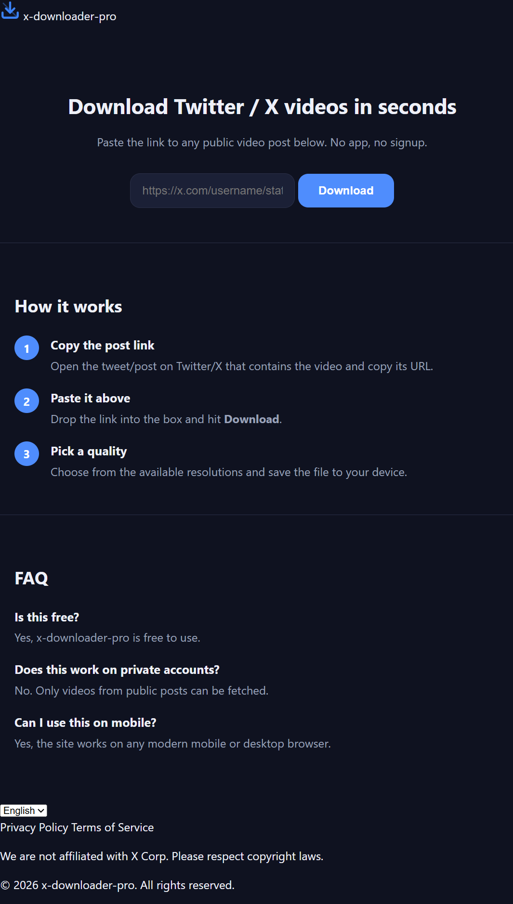

# X Downloader Pro 🚀

A fast, reliable, and modern web application to download videos from X (formerly Twitter) in high quality (up to 1080p). No app, no login, and no watermarks.

🔗 **[Live Demo: x-downloader.us.ci](https://x-downloader.us.ci)**




## ✨ Features

- **High-Quality Downloads:** Fetch videos in multiple resolutions (1080p, 720p, 480p).
- **No Watermark:** Download clean videos directly from the source.
- **No Login Required:** Works entirely on public video links.
- **Mobile & Desktop Ready:** Fully responsive design optimized for iOS, Android, and Desktop browsers.
- **Modern UI:** Built with a sleek dark mode using Tailwind CSS.

## 🛠️ Tech Stack

- **Frontend:** HTML, Tailwind CSS, Vanilla JavaScript
- **Backend:** Node.js / Express
- **Video Extraction:** Custom scraping logic
- **Hosting:** Vercel
- **Domain:** x-downloader.us.ci

## 🏃‍♂️ Getting Started

To get a local copy up and running, follow these simple steps:

### Prerequisites
- Node.js installed on your machine.

### Installation

1. Clone the repository:
   ```bash
   git clone https://github.com/TroyDaveForce/x-downloader-pro.git
2. Navigate to the project directory:
cd x-downloader-pro
3. Install NPM packages:
npm install
4. Start the server:
npm start
5. Open your browser and visit http://localhost:3000 (or whatever port your server runs on). 

## 📈 Roadmap

[ ] Add TikTok Video Downloader page.

[ ] Add Instagram Video Downloader page.

[ ] Add YouTube Thumbnail Downloader page.

[ ] Integrate Google AdSense.

[ ] Add user accounts / Pro tier. 

## 🤝 Contributing
 
 Contributions, issues, and feature requests are welcome! Feel free to check the issues page.
 
## 📫 Connect with Me
 
 TroyDaveForce
 • **GitHub:** [David Ekeke](https://github.com/TroyDaveForce)
 
 • **LinkedIn:** [TroyDaveForce](https://www.linkedin.com/in/david-ekeke)
 
 • **Email:** [ekekedavid147@gmail.com](ekekedavid147@gmail.com) 

## ⚠️ Disclaimer
 
This project is for educational purposes only.
We are not affiliated with X Corp. We do not host any of the videos downloaded through this tool. Users are solely responsible for ensuring they have the right to download and use any content. Please respect copyright laws and the Terms of Service of X (Twitter).
 
## 📄 License
 
This project is licensed under the MIT License - see the LICENSE file for details.
